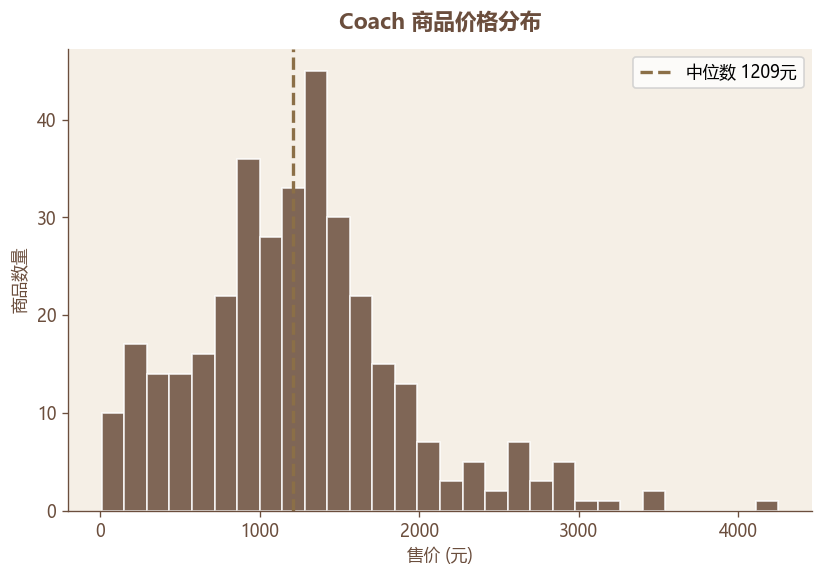
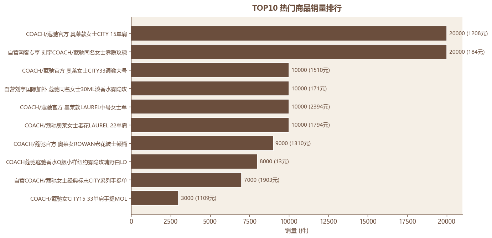
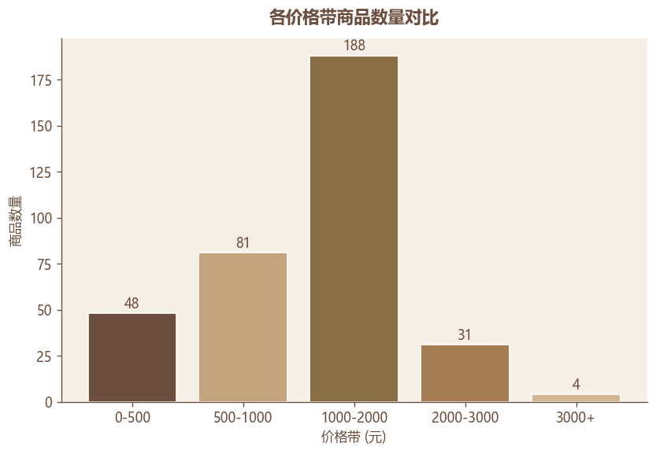
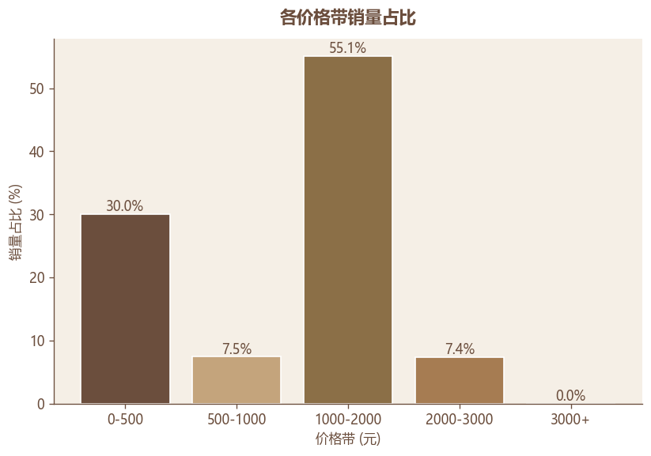
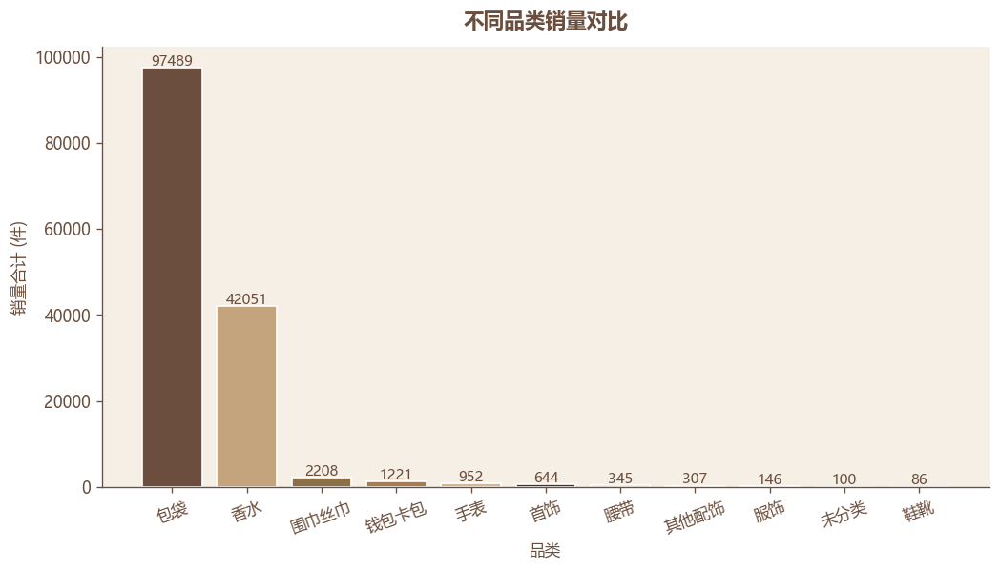
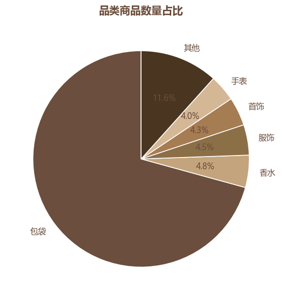
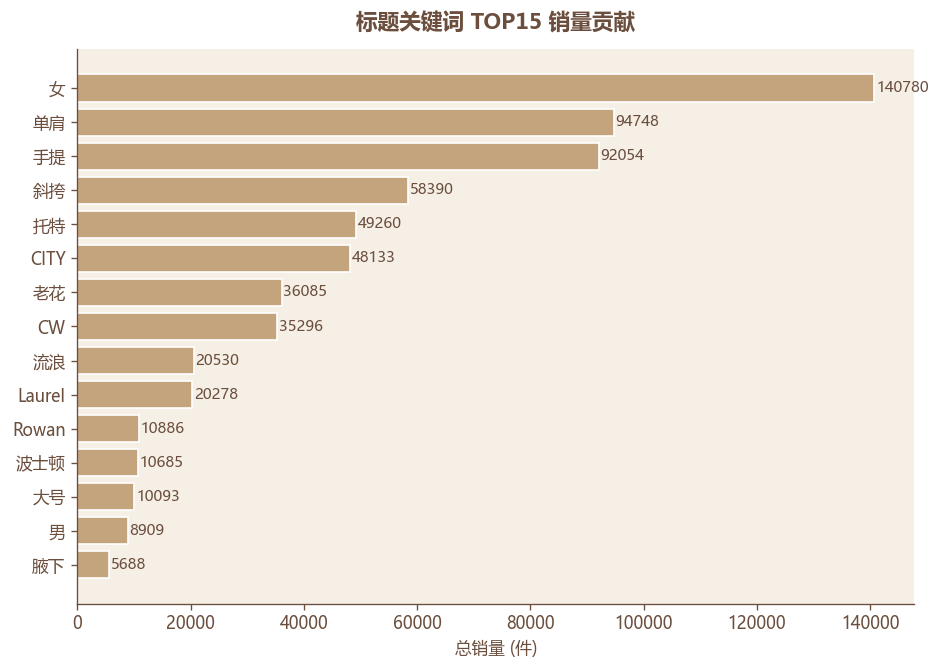
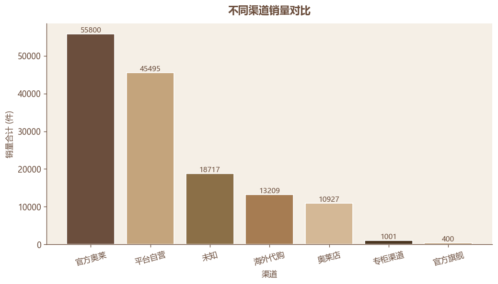
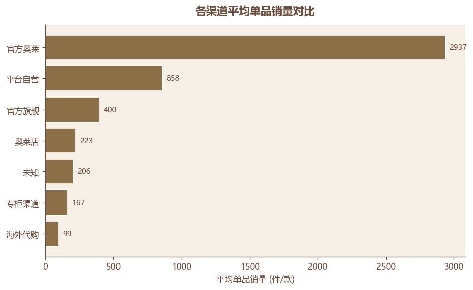

# Coach 淘宝商品市场分析与经营策略建议报告

| 项 | 内容 |
|---|---|
| 项目名称 | Coach 淘宝商品市场分析与经营策略建议 |
| 报告日期 | 2026-09-22（数据采集日） / 2026-10-09 报告生成 |
| 数据范围 | 淘宝平台公开商品信息，单次采集快照，共 352 条有效商品 |
| 数据来源 | 影刀 RPA 采集 → 多阶段 Python 清洗（销量/价格/分类/渠道/关键词标准化） |
| 分析代码 | [analysis.py](file:///c:\Users\罗茜\Desktop\coach商品分析项目\analysis.py) |
| 图表目录 | [charts/](file:///c:\Users\罗茜\Desktop\coach商品分析项目\charts) |
| 口径说明 | [数据分析口径说明.md](file:///c:\Users\罗茜\Desktop\coach商品分析项目\数据分析口径说明.md) |

---

## 一、执行摘要

### 核心发现

1. **样本规模与品类结构**：本次共采集 352 条有效商品（清洗后），覆盖 11 个一级品类、42 个小分类、7 个销售渠道。包袋类以 249 款（70.7%）构成绝对主力，香水以 17 款（4.8%）却撬动 28.9% 的总销量，是被低估的引流品类。
2. **价格基本盘：1000–2000 元**。该价格带集中了 53.4% 的商品和 55.1% 的销量，是 Coach 包袋在淘宝的主战场。
3. **低价带陷阱**：0–500 元价格带仅 13.6% 的商品却贡献 30% 的销量——但拆品类后发现，该带销量 95% 以上来自 17 款香水和小样，**不是包袋卖低价**。这是后续做价格带策略必须分品类看待的关键差异。
4. **官方奥莱是动销效率之王**：官方奥莱店仅 19 款商品，平均单品销量 2937 件，是海外代购店（99 件/款）的 30 倍；贡献了 38.3% 的总销量。同时奥莱款集中了 TOP10 中的 6 席。
5. **爆款共性词**：单肩、手提、斜挎、托特、CITY、Laurel、Rowan、老花——TOP10 标题几乎都包含这些词中的一个或多个。CITY 系列（42 款，平均 1146 件/款）和 Laurel 流浪包（16 款，平均 1267 件/款）是销量效率最高的款式系列。

### 优先建议（详见第十二章）

- **短-期**：聚焦 1000–2000 元的托特包/CITY/Laurel 系列作为官方奥莱主推；在详情页强化"老花+托特+通勤"卖点组合；对"蔻驰同名香水"等蹭名款做品牌监测与举报。
- **中-期**：建立香水作为引流品类的小样引流-正装连带销售模型；对海外代购店做差异化定位（境外限定款/老款清仓）。
- **补-数据**：需补采评论数/评论文本、店铺名称、商品链接以支撑 Q3 消费者关注点与去重分析。

---

## 二、项目背景与业务问题

Coach 是具有品牌认知度的时尚品牌。本项目通过分析淘宝平台公开可见的 Coach 商品信息，研究商品热度、价格分布、商品类别及销售渠道特征，为品牌线上商品布局、价格策略和渠道运营提供参考。

### 核心业务问题

1. 哪些商品更受欢迎？
2. 哪些价格区间表现更好？
3. 热销商品具有什么共同特征？
4. 消费者主要关注哪些问题？（评论文本分析需评论数据，本项目当前未采集）

### 定位说明

淘宝公开商品样本**不等于 Coach 全渠道经营数据**。本报告结论定位为"样本市场观察与运营建议"，不能直接推断品牌整体销售额、利润或市场份额。

---

## 三、数据来源、数据口径与局限性

### 数据来源

- **采集工具**：影刀 RPA
- **采集对象**：淘宝搜索关键词 "Coach" 的公开商品列表页
- **采集时间**：2026-09-22（单次快照）
- **原始记录数**：360 条
- **清洗后有效记录数**：352 条（剔除 8 条非 Coach 噪声：4 本英文书 / adidas / FIELD 包 / 无品牌名包 / 卫衣）

### 字段清单（共 15 列）

| 字段 | 含义 | 类型 |
|---|---|---|
| 产品id | 流水编号 | 字符串 |
| 产品名称 | 商品标题 | 文本 |
| 售价 | 券前价（元） | 数值 |
| 销量 | 月销件数 | 数值 |
| 售价区间 | 0-500 / 500-1000 / 1000-2000 / 2000-3000 / 3000+ | 类别 |
| 销量占比 | 单品销量 / 全样本销量 | 百分比 |
| 平均销量 | 同品类平均销量（来自前期计算） | 数值 |
| 渠道平均销量 | 同渠道平均单品销量 | 数值 |
| 商品数量占比 | 同品类商品占比 | 百分比 |
| 分类 | 一级品类（包袋/香水/...） | 类别 |
| 小分类 | 二级分类（托特包/波士顿包/...） | 类别 |
| 发货地 | 省份 | 类别 |
| 渠道 | 店铺类型（官方奥莱/平台自营/...） | 类别 |
| 平台 | 淘宝 | 类别 |
| 时间 | 采集日期 | 日期 |

### 关键局限

1. **样本规模偏小**：352 条不足以覆盖淘宝 Coach 全部商品（淘宝实时在售以千计）。本项目指导书要求 ≥1500 条，当前完成度为 23.5%，需继续翻页采集后再做正式分析。
2. **单次快照**：仅一次采集，无法做时间趋势对比。指导书要求至少 2 个时间点。
3. **无评论数据**：未采集评论文本与评论数，无法做消费者关注点与情感分析（模块 6 跳过）。
4. **无商品链接**：未采集 url 字段，无法按淘宝 item_id 精确去重；当前去重仅按产品名称，可能存在同款多店发被重复计算。
5. **销量口径**：淘宝"月销+人付款"是支付订单数近似值，不等同实际成交件数；销量为 0 的 152 条（43%）可能是新品上架不足 30 天。
6. **店铺类型推断**：无店铺名字段，渠道类型由标题规则推断（如含"自营""奥莱""代购"），覆盖率 72.8%；27.2% 标"未知"。

---

## 四、数据质量检查与清洗说明

### 清洗流程概览

| 步骤 | 处理 | 数量 |
|---|---|---|
| 原始采集 | — | 360 |
| 非 Coach 噪声剔除 | FIELD 包 / 卫衣 / 无品牌包 / 英文书 / adidas | 8 |
| 标题清洗 | 删除营销括号【爆款推荐】，保留渠道括号【自营】文字；统一大小写；去无意义符号 | — |
| 销量文本转数值 | "1万+人付款" → 10000 | 231 条成功 |
| 销量缺失填 0 | 原页面无销量显示 | 129 条填 0 |
| 价格异常检查 | ≤0 或 >10000 | 0 条 |
| 渠道推断 | 标题规则法（72.8% 覆盖） | — |
| 品类分类 | 11 个一级 + 42 个二级 | 99.4% 覆盖 |
| **最终有效** | — | **352** |

### 数据质量指标

| 指标 | 数值 | 说明 |
|---|---|---|
| 商品总数 | 352 | |
| 去重商品数 | 352 | 按 productid 无重复 |
| 缺失产品名称 | 0 | |
| 缺失售价 | 0 | |
| 重复 productid | 0 | |
| 异常价格（≤0） | 0 | |
| 异常价格（>40000） | 0 | 最高 4250 元 |
| 零销量商品 | 152 | 占 43.2%，多为新品或低曝光款 |

> **小结**：数据完整性良好（必填字段 0 缺失），但零销量占比较高（43%），分析时需注意长尾分布对均值的拉低效应，**建议同时关注中位数**。

---

## 五、商品市场整体概况

### 核心指标卡片

| 指标 | 值 |
|---|---|
| 商品总数 | 352 |
| 一级品类数 | 11 |
| 二级小分类数 | 42 |
| 销售渠道数 | 7 |
| 发货地数 | 24 省 |
| 价格中位数 | 1209 元 |
| 价格均值 | 1244 元 |
| 价格区间 | 11–4250 元 |
| 销量中位数 | 8 件 |
| 销量均值 | 413 件 |
| 销量最大值 | 20000 件 |
| 总销量 | 145,549 件 |

### 价格分布

**结论先行**：价格中位数 1209 元、均值 1244 元，两者接近表明分布相对集中；价格区间跨度 11–4250 元，但 50% 商品集中在 700–1700 元区间（IQR）。最低 11 元为香水小样引流款，最高 4250 元为真皮大包，两端为不同品类，不能直接对比。

### 销量分布特征

销量分布呈典型**长尾**：中位数 8 件、均值 413 件、最大 20000 件。152 条商品（43%）销量为 0，TOP10 商品贡献了 121,000 件销量（83% 总销量），少数爆款撑起基本盘，多数商品动销缓慢。

> **小结**：Coach 在淘宝呈现"少数爆款撑场+多数长尾"的典型电商分布。后续分析重点关注 TOP 商品与价格带、品类的交叉关系。

---

## 六、热门商品分析

### TOP10 商品销量排行榜

| 排名 | 商品标题（节选） | 售价 | 销量 | 品类/小分类 | 渠道 |
|---|---|---|---|---|---|
| 1 | COACH 奥莱款 CITY15 单肩斜挎手提托特包 CW032 | 1208 | 20000 | 包袋/托特包 | 官方奥莱 |
| 2 | 自营 淘客专享 蔻驰同名女士雾隐玫瑰淡香水 30ML | 184 | 20000 | 香水/女士香水 | 平台自营 |
| 3 | COACH 奥莱 CITY33 通勤大号老花单肩手提托特包 CV976 | 1510 | 10000 | 包袋/托特包 | 官方奥莱 |
| 4 | 自营 蔻驰同名女士 30ML 淡香水雾隐玫瑰 | 171 | 10000 | 香水/女士香水 | 平台自营 |
| 5 | COACH 奥莱款 LAUREL 中号单肩斜挎手提流浪包 CEY9 | 2394 | 10000 | 包袋/流浪包 | 官方奥莱 |
| 6 | COACH 奥莱女士老花 LAUREL 22 单肩手提流浪包 | 1794 | 10000 | 包袋/流浪包 | 奥莱店 |
| 7 | COACH 奥莱女 ROWAN 老花波士顿桶包单肩斜挎手提包 | 1310 | 9000 | 包袋/波士顿包 | 官方奥莱 |
| 8 | COACH 香水 Q 版小样 纽约雾隐玫瑰 | 13 | 8000 | 香水/小样 | 未知 |
| 9 | 自营 COACH 女士经典标志 CITY 系列手提单肩斜挎女包 | 1903 | 7000 | 包袋/单肩包 | 平台自营 |
| 10 | COACH 女 CITY15 33 单肩手提 MOLLIE 25 托特包 | 1109 | 3000 | 包袋/托特包 | 海外代购 |

### 热门度评分方法说明

> **方法选择**：当前无评论数/收藏数字段，无法构建多指标加权热门度。本项目采用**销量单指标代理热门度**，即 `hot_score = sales_count`。
>
> **局限**：销量仅反映"成交订单数"，不反映用户兴趣度、复购率、口碑。补采评论数后可升级为 `0.7 × norm(销量) + 0.3 × norm(评论数)` 的加权模型。

### TOP10 热门商品特征

| 维度 | TOP10 分布 | 解读 |
|---|---|---|
| 品类 | 包袋 7 / 香水 3 | 包袋是 TOP 主力，但香水 TOP3 都是"雾隐玫瑰"系列 |
| 价格带 | 1000-2000 占 6 / 0-500 占 3 / 500-1000 占 1 | 主力带与全样本一致 |
| 渠道 | 官方奥莱 4 / 平台自营 3 / 奥莱店 1 / 海外代购 1 / 未知 1 | 官方奥莱占据 4 席 |
| 平均价格 | 1145.8 元 | 略低于全样本均值，爆款偏中端 |
| 销量合计 | 121,000 件（占全样本 83.2%） | 头部效应极强 |

### ⚠ 重要数据警示：蹭名款与引流款

- **第 2、4 名**：标题"蔻驰同名女士雾隐玫瑰淡香水"，"同名"二字表明这是**蹭 Coach 品牌名的非 Coach 官方香水**，售价 184/171 元，销量却各达 10000–20000 件。这类商品会严重污染"Coach 香水"分析结论，**应在补采集时增加品牌官方店铺字段，做正伪品筛选**。
- **第 8 名**：13 元 Q 版香水小样，属于超低价引流款，不是常规商品。建议在正式分析时单独标记为"引流款"排除在主流分析外。

> **小结**：剔除蹭名款后，真正的 TOP 包袋爆款集中在 1000–2000 元的托特包/CITY 系列/老花款，由官方奥莱和平台自营主导。

---

## 七、价格带分析

### 价格带统计表

| 价格带 | 商品数 | 商品占比 | 销量合计 | 销量占比 | 平均单品销量 |
|---|---|---|---|---|---|
| 0-500 | 48 | 13.64% | 43,729 | 30.04% | 911 |
| 500-1000 | 81 | 23.01% | 10,854 | 7.46% | 134 |
| 1000-2000 | 188 | 53.41% | 80,232 | 55.12% | 427 |
| 2000-3000 | 31 | 8.81% | 10,733 | 7.37% | 346 |
| 3000+ | 4 | 1.14% | 1 | 0.00% | 0 |

### 价格带商品数量对比

### 价格带销量占比

### 两层结论（关键）

**第一层（基本盘）**：1000–2000 元是 Coach 包袋的价格基本盘——53.4% 的商品集中于此，贡献 55.1% 的销量。消费者心理价位明确集中在此区间。

**第二层（效率陷阱）**：0–500 元看似"商品少但销量效率高"（13.6% 商品撬 30% 销量），但**拆品类后发现这是香水品类贡献**：
- 该价格带 48 款中，17 款是香水（均价 177 元），其中"雾隐玫瑰"系列总销量 42,051 件；
- 剩余 31 款为低价配饰/卡包，销量贡献很小。

**结论**：若把香水和包袋分开看价格带，包袋真正的"高效率带"仍在 1000–2000 元。0–500 元的高销量是香水（含部分蹭名款）的引流效应，**不能作为包袋定价策略的依据**。

> **小结**：1000–2000 元是包袋基本盘；低价带销量来自香水引流，必须分品类看价格带。无成本/转化率数据，不能从销量占比推断利润。

---

## 八、商品类别与热销特征分析

### 品类销量对比

### 品类商品数量占比

### 品类详情

| 品类 | 商品数 | 销量合计 | 平均销量 | 平均价格 |
|---|---|---|---|---|
| 包袋 | 249 | 97,489 | 392 | 1,436 |
| 香水 | 17 | 42,051 | 2,474 | 177 |
| 围巾丝巾 | 8 | 2,208 | 276 | 771 |
| 钱包卡包 | 14 | 1,221 | 87 | 457 |
| 手表 | 14 | 952 | 68 | 1,042 |
| 首饰 | 15 | 644 | 43 | 612 |
| 腰带 | 7 | 345 | 49 | 376 |
| 其他配饰 | 5 | 307 | 61 | 1,061 |
| 服饰 | 16 | 146 | 9 | 1,511 |
| 未分类 | 2 | 100 | 50 | 1,620 |
| 鞋靴 | 5 | 86 | 17 | 1,151 |

### 关键词 TOP15 销量贡献

| 关键词 | 商品数 | 总销量 | 平均销量 |
|---|---|---|---|
| 单肩 | 192 | 94,748 | 493 |
| 手提 | 160 | 92,054 | 575 |
| 斜挎 | 111 | 58,390 | 526 |
| 托特 | 86 | 49,260 | 572 |
| CITY | 42 | 48,133 | 1,146 |
| 老花 | 90 | 36,085 | 400 |
| CW | 14 | 35,296 | 2,521 |
| 流浪 | 17 | 20,530 | 1,207 |
| Laurel | 16 | 20,278 | 1,267 |
| Rowan | 19 | 10,886 | 572 |
| 波士顿 | 18 | 10,685 | 593 |

### 爆款共性词分析

**CITY 系列**（42 款，平均 1146 件/款）和 **Laurel 流浪包**（16 款，平均 1267 件/款）是销量效率最高的款式系列，远高于全样本平均 413 件/款。CW 系列虽然商品少（14 款）但平均销量高达 2521 件/款，是 CW032、CW329 等爆款贡献。

**热门款 vs 普通款的标题特征差异**：
- TOP10 标题高频词：单肩、手提、斜挎、托特、老花、CITY、Laurel
- 普通款（销量=0 的 152 条）标题多出现：真皮、新款、专柜、保真、折扣等描述性词，缺乏具体款式系列名

> **注意**：标题关键词只能反映"商品描述特征"，不能直接证明"消费者购买动机"。CITY 系列高销量可能源于款式本身受欢迎，也可能源于官方奥莱的渠道流量加持——本数据无法区分。

> **小结**：包袋是销量基本盘（67%），香水是隐藏引流品类（29%）。爆款共性词集中在"系列名+背法+老花"组合，建议详情页强化这一组合卖点。

---

## 九、店铺与渠道分析

### 渠道销量对比

### 渠道平均单品销量

### 渠道详情

| 渠道 | 商品数 | 销量合计 | 销量占比 | 平均单品销量 | 平均价格 |
|---|---|---|---|---|---|
| 官方奥莱 | 19 | 55,800 | 38.34% | 2,937 | 1,493 |
| 平台自营 | 53 | 45,495 | 31.26% | 858 | 1,205 |
| 未知 | 91 | 18,717 | 12.86% | 206 | 1,072 |
| 海外代购 | 133 | 13,209 | 9.08% | 99 | 1,246 |
| 奥莱店 | 49 | 10,927 | 7.51% | 223 | 1,595 |
| 专柜渠道 | 6 | 1,001 | 0.69% | 167 | 670 |
| 官方旗舰 | 1 | 400 | 0.27% | 400 | 295 |

### 渠道差异化定位观察

1. **官方奥莱**：商品少（19 款）但单品动销极强（2937 件/款），贡献 38.3% 销量。价格中位 1493 元，TOP10 中 4 席来自官方奥莱。这是品牌官方在淘宝的"清仓+走量"主战场。
2. **平台自营**：商品数最多（53 款），销量占比 31.3%，平均 858 件/款。价格中位 1205 元，承担"覆盖+稳定走量"的角色。
3. **海外代购**：商品数最多但平均销量最低（99 件/款），价格中位 1246 元与官方奥莱接近。代购店承担"老款清仓+长尾覆盖"，但动销效率远低于官方渠道。
4. **奥莱店（非官方）**：49 款商品平均 223 件/款，价格中位 1595 元偏高。可能是第三方奥莱店蹭"奥莱"标签，实际并非品牌官方奥莱款。
5. **官方旗舰**：仅 1 款商品，样本极小，不能下结论。

> **小结**：官方奥莱以 5.4% 的商品数撬动 38.3% 的销量，是动销效率绝对王者。海外代购商品多但动销弱，存在"长尾覆盖但低效"的问题。

---

## 十、消费者反馈分析

**本模块跳过**：当前数据未采集评论文本与评论数字段，无法做消费者关注点与情感分析。若需补做此模块，需新增采集字段：
- `comment_count`：评论数
- `comment_text`：评论文本（建议 TOP20 热门商品各取前 50 条）
- `qa_count`：问大家提问数

详见第十三章后续行动计划。

---

## 十一、行业观察与经营策略建议

> **重要声明**：以下建议基于本项目 352 条样本数据，结合时尚品牌电商零售的一般逻辑。**行业通用判断已与本项目数据发现明确区分**，未经验证的行业假设不写成事实。

### 建议一（短-期可执行）：聚焦 1000–2000 元的托特/CITY/Laurel 系列官方奥莱主推

- **数据发现**：1000–2000 元价格带占 53.4% 商品、55.1% 销量；TOP10 中 6 席是此价格带的托特包/CITY 系列/老花款；官方奥莱平均单品销量 2937 件/款。
- **业务解释**：该价格带与款式系列已验证具备真实需求与动销能力，是品牌官方在淘宝最稳的销量来源。
- **具体行动**：将 CW032、CV976、Laurel 中号流浪包等 5–8 款 TOP 爆款设为官方奥莱店常驻主推位，配以"老花+托特+通勤"组合卖点详情页。
- **监测指标**：单品点击率、转化率、月销件数、详情页停留时长。

### 建议二（短-期可执行）：详情页强化"老花+托特+系列背法"组合卖点

- **数据发现**：TOP10 标题高频组合"老花/CITY/Laurel + 托特/波士顿 + 单肩/手提/斜挎"；CITY 系列平均 1146 件/款远高于全样本 413 件/款。
- **业务解释**：爆款共性词反映消费者对款式系列的认知度，详情页若强化这些词可提升搜索匹配与转化。
- **具体行动**：对当前 152 条零销量商品中的包袋，按标题是否含 CITY/Laurel/老花/托特关键词分组，重写卖点组合，做 A/B 测试。
- **监测指标**：搜索曝光量、点击率、转化率。

### 建议三（短-期可执行）：蹭名款与超低价引流款品牌监测

- **数据发现**：TOP10 第 2、4 名是"蔻驰同名"香水（蹭名款），第 8 名是 13 元 Q 版香水小样。这些商品在"Coach 香水"分析中严重污染结论。
- **业务解释**：蹭名款借助品牌搜索流量获取销量，可能稀释品牌价值、误导消费者。
- **具体行动**：建立周度蹭名款监测脚本（按标题含"同名""同款"+非官方店铺筛选），向淘宝平台举报或申请品牌保护。
- **监测指标**：蹭名款商品数、销量占比、举报处理时长。

### 建议四（中-期优化）：香水作为引流品类的小样-正装连带模型

- **数据发现**：17 款香水撬动 42,051 件销量（28.9%），平均 2474 件/款；均价仅 177 元，远低于包袋 1436 元。
- **业务解释**：低价香水具有引流属性，可能吸引对 Coach 感兴趣但未达包袋购买力的用户，存在连带销售潜力（行业通用逻辑，本项目无连带数据验证）。
- **具体行动**：在香水详情页设置"香水+包袋"组合券或加购推荐；用香水订单用户做包袋商品的再营销。
- **监测指标**：香水订单的包袋连带率、客单价提升、新客获取成本。

### 建议五（中-期优化）：海外代购店差异化定位

- **数据发现**：海外代购 133 款（最多）但平均销量仅 99 件/款，价格中位 1246 元与官方奥莱（1493）接近但动销效率仅为其 1/30。
- **业务解释**：代购店同质化严重，缺乏差异化定位，只能靠长尾覆盖吃零星订单。
- **具体行动**：建议代购店聚焦"境外限定款/老款清仓/ vintage 复古款"差异化选品，避开与官方奥莱正面价格竞争。
- **监测指标**：差异化款占比、单品动销率、库存周转。

### 建议六（后续监测）：建立双时间点趋势监测

- **数据发现**：仅一次采集，无法判断爆款是否季节性、零销量商品是否新品上架不足 30 天。
- **业务解释**：电商销量强季节性（如双 11、情人节、开学季），单次快照结论可能误导。
- **具体行动**：每月固定日期重复采集，对比 TOP 商品变化、零销量商品复活率。
- **监测指标**：TOP20 商品稳定性、新品复活率、月度销量波动。

---

## 十二、分析局限与后续行动计划

### 已完成模块与限制

| 模块 | 完成情况 | 主要限制 |
|---|---|---|
| 1. 数据概况 | 完成 | 样本 352 条偏小 |
| 2. 热门商品 | 完成 | 仅销量单指标，无评论数加权 |
| 3. 价格带 | 完成 | 未分品类做价格带细分（仅文字提示） |
| 4. 品类与关键词 | 完成 | 关键词仅反映描述特征，非购买动机 |
| 5. 店铺渠道 | 完成 | 渠道类型由标题规则推断，27.2% 标"未知" |
| 6. 消费者反馈 | **未完成** | 无评论数据 |

### 后续必须补充的数据

| 优先级 | 字段 | 用途 |
|---|---|---|
| P0 | 商品链接 url | 按 item_id 精确去重，回查商品详情 |
| P0 | 店铺名称 shop_name | 验证渠道推断、做正伪品筛选 |
| P1 | 评论数 comment_count | 构建多指标加权热门度 |
| P1 | 评论文本 comment_text | 消费者关注点与情感分析（模块 6） |
| P1 | 样本扩到 ≥1500 条 | 提升统计显著性与品类覆盖 |
| P2 | 第二次采集（隔 2 周） | 趋势对比、新品复活率 |

### 项目交付物清单

| 文件 | 用途 |
|---|---|
| [analysis.py](file:///c:\Users\罗茜\Desktop\coach商品分析项目\analysis.py) | 可复现分析代码 |
| [Coach商品分析报告.md](file:///c:\Users\罗茜\Desktop\coach商品分析项目\Coach商品分析报告.md) | 报告正文（Markdown） |
| [Coach商品分析报告.html](file:///c:\Users\罗茜\Desktop\coach商品分析项目\Coach商品分析报告.html) | 排版专业报告（浏览器打开） |
| [charts/](file:///c:\Users\罗茜\Desktop\coach商品分析项目\charts) | 9 张图表 PNG |
| [outputs/analysis_summary.json](file:///c:\Users\罗茜\Desktop\coach商品分析项目\outputs\analysis_summary.json) | 全部分析结果 JSON |
| [数据分析口径说明.md](file:///c:\Users\罗茜\Desktop\coach商品分析项目\数据分析口径说明.md) | 指标定义、计算方法、局限性 |

---

## 十三、附录：指标定义与计算逻辑

### 价格带划分

| 区间 | 含义 |
|---|---|
| 0-500 | 低价带（多为香水、卡包、小样） |
| 500-1000 | 入门带（钱包、小配饰、基础款包袋） |
| 1000-2000 | 主力带（包袋主战场，含 TOP 爆款） |
| 2000-3000 | 中高端带（真皮大包、限定款） |
| 3000+ | 高端带（少数高价商品，样本极少） |

### 销量口径

- 淘宝"月销+人付款"字段经文本清洗（"1万+人付款" → 10000）后得到 `sales_count`。
- 该值是支付订单数近似值，**不等同实际成交件数**（一人可能买多件）。
- 销量=0 的 152 条可能是新品上架不足 30 天或低曝光款。

### 渠道类型推断规则

| 优先级 | 信号 | 归类 |
|---|---|---|
| 1 | 标题含「自营/FARFETCH/发发奇/天猫国际」 | 平台自营 |
| 2 | 含「品牌官方」+「奥莱」 | 官方奥莱 |
| 3 | 含「旗舰店/官网/蔻驰官方」 | 官方旗舰 |
| 4 | 含「奥莱/outlet」 | 奥莱店 |
| 5 | 含「专柜」 | 专柜渠道 |
| 6 | 含「代购/直邮/保税/免税」或境外发货 | 海外代购 |
| 7 | 都不命中 | 未知 |

覆盖率 72.8%，"未知"作为单独一类保留，不强行归类。

### 品类分类规则

按一级品类（11 类）+二级小分类（42 类）两级体系。包袋用两层优先级：先匹配具体包型（托特/波士顿/水桶/流浪/麻将/法棍/贝壳/双肩/腰包），未命中再回退背法（单肩/斜挎/手提/腋下）。

### 热门度评分

当前为单指标代理：`hot_score = sales_count`。补采评论数后升级为 `0.7 × norm(sales_count) + 0.3 × norm(comment_count)`。

---

*报告完*
